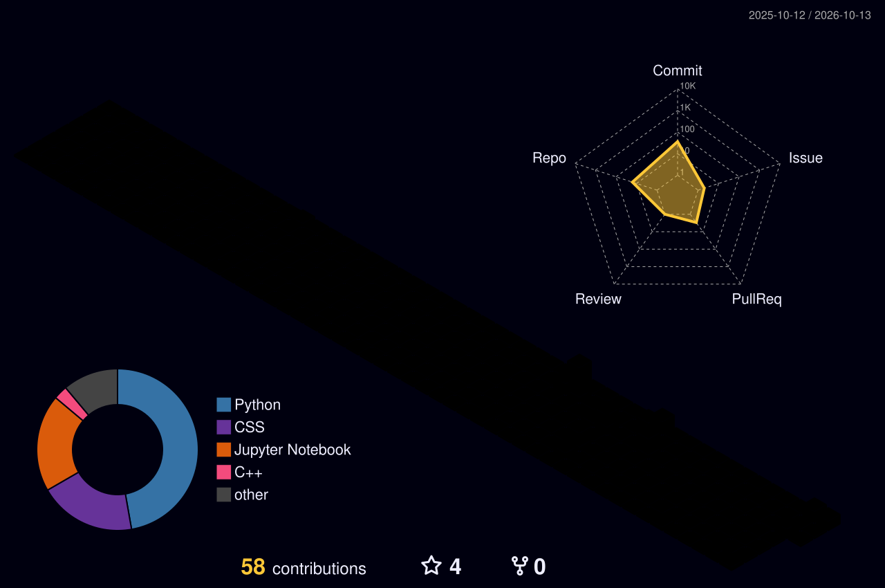

<!-- ═══════════════ HEADER ═══════════════ -->
<div align="center">


<a href="https://talhaamin.tech">
  
</a>

<br/><br/>

<a href="https://talhaamin.tech"></a>

</div>

<br/>

<!-- ═══════════════ ABOUT ═══════════════ -->


<table>
<tr>
<td width="62%" valign="top">

```python
class Talha:
    name       = "Muhammad Talha Amin"
    role       = ["Data Science Undergraduate", "ML Engineering Intern"]
    university = "PUCIT (University of the Punjab)"
    focus      = ["Machine Learning", "Data Analysis", "AI", "Full Stack"]
    languages  = ["Python 🐍", "SQL", "HTML/CSS"]

    def mission(self):
        return "Learn by building. Ship useful things. Repeat. 🔁"
```

</td>
<td width="38%" align="center" valign="middle">


<br/><br/>
<b>🔭 Currently building</b><br/>
Fraud-detection ML pipelines<br/>
& AI-powered apps
<br/><br/>
<b>🌱 Always learning</b><br/>
RAG systems • MLOps • Deep Learning

</td>
</tr>
</table>

<!-- ═══════════════ TECH STACK ═══════════════ -->


<div align="center">


<br/>

<br/><br/>


</div>

<!-- ═══════════════ FEATURED PROJECTS ═══════════════ -->


| Project | What it does | Stack |
|:--|:--|:--|
| 🎟️ **[Tixora](https://tixora-lemon.vercel.app)** | AI-powered secure event ticketing with real-time fraud detection, verified QR-code tickets, and an organizer analytics dashboard | `Python` `ML` `Flask` |
| 📓 **[Data Science Notebooks](https://github.com/Muhammad-TalhaAmin/data-science-notebooks)** | Jupyter explorations with pandas, NumPy, Matplotlib, Seaborn, Plotly | `Jupyter` `pandas` `Plotly` |
| 🎶 **[Musical Time Machine](https://github.com/Muhammad-TalhaAmin/Musical-Time-Machine)** | Recreates playlists from any historical date via API integration | `Python` `APIs` |
| 🔒 **[Password Manager](https://github.com/Muhammad-TalhaAmin/Password-Manager-App)** | Desktop tool for safely storing credentials while learning GUI development | `Python` `GUI` |

<!-- ═══════════════ 3D CONTRIBUTIONS ═══════════════ -->


<div align="center">

<!-- Generated by the workflow in .github/workflows/profile-3d.yml -->


</div>

<!-- ═══════════════ STATS ═══════════════ -->


<div align="center">


<br/>


<br/><br/>


</div>

<!-- ═══════════════ SNAKE ═══════════════ -->


<div align="center">


</div>

<!-- ═══════════════ CONNECT ═══════════════ -->


<div align="center">

<a href="https://talhaamin.tech"></a>
<a href="https://www.linkedin.com/in/talha-amin-1a3785288/"></a>
<a href="mailto:talhaamin741@gmail.com"></a>

<br/><br/>


<br/>


</div>
